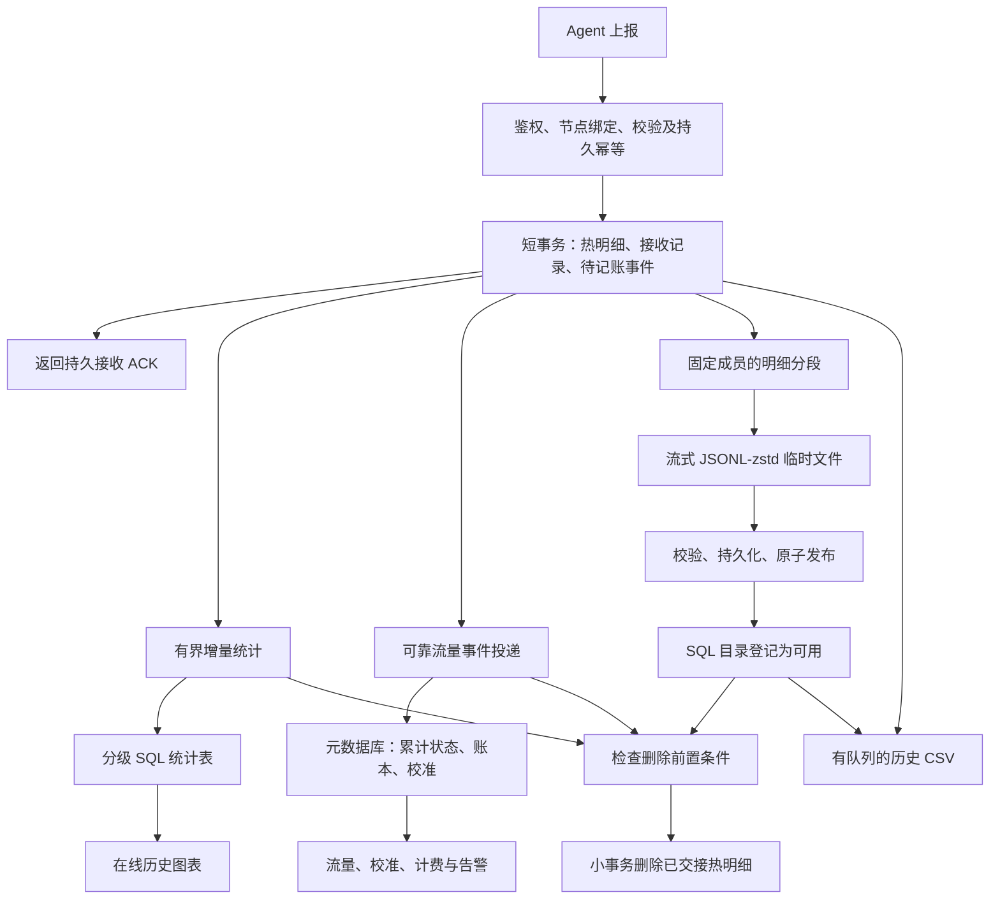

# Komari 指标存储改造方案：SQL 热数据、分级统计与 JSONL-zstd 冷归档

- 编写日期：2026-11-10。
- 状态：已进入实现与验收；实际阶段、CI/E2E 证据及未完成项见 [实施检查点](telemetry-storage-implementation.md)。本设计的目标值不代表已经测得的性能。
- 2026-11-11 补强：[图表精度、跨层查询、流量时间边界与 CSV 资源预算](telemetry-storage-reinforcement-plan.md)。该文修订相冲突的查询/保留/导出要求，新增事项尚未实施和验收；原有绿色 CI 不覆盖新发现的问题。
- CSV 追加要求见补强方案第 6 节：小时级后台任务、三种明确格式、真实阶段进度及所有导出合计不超过全部有效 CPU 的 10%；该要求取代先前更宽的导出预算，尚待代码与持续负载验收。
- 源码核对基线：后端 `2d5434e71e92702f2edc4c93a969411e87bd6be7` 及其固定的 Web 子模块。
- 主要环境：Debian、Docker 后端、Nginx/Xray 反代；重点验收约 1 vCPU / 1 GiB 的部署。
- 目标：替换当前 SQL 内压缩块及其维护路径，降低历史明细对在线查询、写锁和后台维护的影响。
- 本方案仅修改遥测数据及其派生统计的存储方式，不改变远控授权、插件信任、人工验证或 Token 权限边界。

## 1. 设计结论

采用以下架构：

1. 完整采样先可靠进入普通 SQL 热表，使用简单、可索引的行存储。
2. 数据处于热区时，完成增量统计和流量记账所需的处理。
3. 已结束的明细分段流式归档为不可变的 `.jsonl.zst` 文件。
4. 确认归档持久化、统计完成、记账事件已安全转交后，分批删除对应 SQL 明细。
5. 在线历史图表读取小型分级统计表；近期未完成桶只读取有界的热数据。
6. 冷明细主要服务管理员导出和显式恢复，不成为普通图表查询的隐式后备数据源。
7. 流量累计、小时/日期/计费周期账本和校准记录独立持久化，正常查询不再扫描指标历史。

旧引擎的块编码、共享时间轴、历史块重写及旧维护循环退出新运行路径。保留现有业务统计的含义，重新实现其存储、推进和查询。

这是面向本项目访问模式的存储简化，不引入一套通用 TSDB 服务，不要求额外部署数据库集群或对象存储。

## 2. 已核实的现状与问题范围

### 2.1 页面实际上怎样查询

| 调用方 | 当前行为 | 新架构要求 |
| --- | --- | --- |
| 节点历史图表 | 聚合查询；每序列目标 700 点；支持 avg/min/max/first/last/stddev/P95/P99 等 | 从统计表返回，维持算法含义 |
| 迷你 Ping 图 | 平均值曲线约 240 点，并查询 Ping 汇总 | 使用时延统计和真实探测次数 |
| 最近历史回填 | 聚合查询，默认约 30 分钟 / 150 点 | 使用适合的近期统计和有限热数据 |
| 实时图 | 多数指标来自实时上报状态，部分指标仍有历史查询 | 逐项核对，避免漏掉特殊指标 |
| `downsample=false` | 后端 API 支持；当前内置 Web 调用没有主动设置该值 | 作为兼容接口单独规定，不作为长期在线明细的理由 |
| 管理员 CSV | 查询 raw，再按当前导出规则整理成 30 秒行 | 读取热数据和冷归档，维持现有导出语义 |

“页面请求聚合结果”不等于“当前底层从不扫描 raw”。新架构要消除正常历史查询对大范围 raw 扫描的依赖。

### 2.2 当前数据留存配置

| 配置状态 | 当前源码含义 |
| --- | --- |
| `metric_downsampling_enabled=false`，默认值 | 保留 raw 到指标自身留存期限，同时仍生成统计层 |
| preserve-raw 模式中的 2 小时 | 统计物化延迟，不是 raw 仅保留两小时 |
| `metric_downsampling_enabled=true` | 默认 raw 窗口 15 分钟，之后使用降采样交接 |
| 新建内置指标 | 默认保留 1 天；已有定义保持原配置，不能据此推断部署实例仅保留一天 |
| preserve-raw 统计层 | 1m/6h、5m/1d、15m/7d、30m/15d、45m/30d、1h/指标期限，受指标期限裁剪 |

新架构不照搬这些层级，也不继续让一个“是否降采样”的开关同时表达原始数据所有权、图表精度和统计加速。

### 2.3 当前流量并非完全独立于指标库

过去完整日期已有每日账本，校准也有独立记录；但当天用量、缺失日期补账、周期首日边界等仍调用 `MetricUsage` 等路径回查指标。

新设计明确解除这种在线依赖。旧历史回填只保留为迁移或管理员显式修复任务，不能在打开看板、校准或读取流量时自动扫描历史明细。

### 2.4 事故证据能证明的范围

现有证据包含约 552 MB 指标库、约 1067 万逻辑点、清理积压、维护超时和约 30 秒周期的 CPU 尖峰；其中一组事故没有历史查询，不能把问题全部归因于浏览器。

本方案针对大库重处理、统计重复工作、维护提交进展和查询扫描范围。最终 CPU 改善需在一致性数据库副本和固定负载下验证；日志中的推算不替代 profile。

## 3. 范围与不变量

### 3.1 本次应一起改的内容

- 普通 SQL 热表、新统计表、归档目录及归档文件格式。
- 上报持久化幂等、统计处理进度、流量事件可靠转交。
- 独立流量累计状态、小时/日期/周期账本与校准读取。
- 图表查询路由、实际分辨率、范围/内存/结果预算。
- 历史 CSV、归档保留与删除、备份恢复。
- 旧库迁移、影子比对、切换与回退机制。
- 与新数据生命周期配套的维护调度，替换旧周期性重活。
- 必要的设置页、容量与积压诊断。

### 3.2 必须始终成立

1. 已确认接收的数据有明确的持久化位置，不能仅存在于内存聚合器。
2. 同一上报重试不能重复增加图表统计或流量账本。
3. raw 删除前，其应保留的冷归档和统计必须完成；流量可靠转交状态不能丢失。
4. 文件和 SQL 之间不假装存在原子事务，使用可恢复的状态机交接。
5. 图表读取的节点范围在 SQL 扫描前就等于授权范围。
6. 已封存的历史文件正常情况下不解压重写；迟到数据使用补充段。
7. 归档失败不能静默删除未归档数据；磁盘压力必须可见并有明确处理策略。
8. 管理员删节点/删指标/清历史应覆盖热表、统计、归档和备份约定，不能只删 SQL。
9. 校准与原始计量分开；指标留存或删除不应意外重置有效计费累计。
10. Store 读取继续使用本轮已修复的生命周期租约，Reload/Close 等待在用实例退出。

## 4. 总体数据流



统计、归档与记账可独立推进，但删除必须等待它们的必要交接条件全部满足。一个任务失败不应迫使其他任务从头重跑。

## 5. 数据模型建议

以下为逻辑表设计，不是已经执行的 SQL。实现时为 SQLite/MySQL/PostgreSQL 分别提供 DDL 与事务适配，禁止把 SQLite 文件操作套用到外部 SQL。

### 5.1 遥测 SQL 数据库

| 逻辑表 | 主要字段/键 | 用途与规模约束 |
| --- | --- | --- |
| `telemetry_series` | series_id、agent_id、metric、规范化 tags、定义版本 | 序列字典；限制标签基数；归档不能仅依赖其日后仍存在 |
| `telemetry_ingest_receipts` | agent_id、批次身份、payload_hash、接收结果、持久游标 | 重试去重；热保留与淘汰策略需有协议保证 |
| `telemetry_hot` | ingest_id、point_ordinal、series_id、observed_at、received_at、value、labels、segment_id | 完整明细；`(ingest_id, point_ordinal)` 唯一；按分段/序列时间索引 |
| `telemetry_summary` | series_id、resolution、bucket_start、统计字段、revision、sealed | 普通 SQL 统计桶；唯一键为序列/粒度/桶起点 |
| `telemetry_progress` | 任务/分区、输入水位、输出版本、最后成功时间 | 统计和清理恢复；必须与输出一起提交 |
| `telemetry_segments` | segment_id、成员边界、范围、状态、统计/归档/删除进度 | 固定分段成员，协调不可逆删除 |
| `telemetry_archive_catalog` | archive_id、segment_id、相对路径、范围、数量、校验和、schema_version、状态 | 为导出选文件，记录损坏/缺失/删除状态 |
| `telemetry_traffic_outbox` | event_id、agent_id、顺序号、计数/增量输入、时间、投递状态 | 跨库可靠转交；未确认事件不得清理 |

`ingest_id` 是持久、单调的接收身份，不假设旧表存在 SQLite rowid；现有部分热表是 WITHOUT ROWID。

热点索引至少支持：按固定 segment 顺序扫描、按授权 series 和时间范围读取、按待处理事件游标推进。索引数量通过写入基准决定，禁止为每个诊断字段建索引。

### 5.2 元数据库中的流量数据

| 逻辑对象 | 保存内容 |
| --- | --- |
| 每节点累计状态 | 上次接受的计数、时间、顺序/重置状态、已确认累计、账本水位 |
| 小时账本 | 每节点每小时的整数上传/下载字节及完整性状态 |
| 日期账本 | 日累计，沿用现有业务日期口径，避免迁移时静默换时区 |
| 周期账本/边界 | 已配置周期的起止、累计和非午夜边界状态 |
| 校准记录 | 原校准目标、调整、计费口径、操作者、时间和适用周期 |
| 事件消费收据 | 已应用 event_id/连续水位，与累计和账本同事务提交 |

尽量复用现有账本和校准表，通过必要的新状态表补齐，不重复建一套含义相同的业务数据。

### 5.3 接收幂等与兼容约束

当前后端 Metrics sequence 去重状态在内存中；不能直接把这个内存计数当成重启后的可靠记账凭据。

新入口必须持久记录已接受批次，并区分“同一批次重试”和“相同序号但内容不同”。同身份不同 payload 应拒绝或进入明确的协议恢复，不能直接 ACK 丢掉新数据。

实施前核对 Agent 的序号初始化、进程重启、断线重采样和重试行为。若现协议不能提供稳定批次身份，增加向后兼容的可选启动代次/批次 ID，并在 Agent 持久队列中复用该身份。不得单独要求 sequence 永远递增而把旧 Agent 重启后的上报全部去重掉。

旧 Agent 兼容模式需要单独测试和标明保证范围。用采样内容哈希去重也必须限定时间/会话，不能把不同时间、数值相同的真实采样合并掉。

长期只保留压缩水位时，要保证晚到旧批次被拒绝/识别，不能在收据过期后重新应用到流量累计。乱序缺口、启动代次和收据回收是一套协议，必须一起定义。

### 5.4 时间字段与数值

- 分开保存原始 `observed_at` 与面板 `received_at`，避免丢掉采样时间和断线迟到信息。
- 分桶时间与流量记账时间分别定义；保留现有记账口径的兼容测试，不直接信任 Agent 时钟作为任意历史账本的修改权限。
- 时间范围内部统一 `[start, end)`，对接旧的闭区间 API 时显式转换，避免边界重复。
- 图表浮点值维持 float64；流量累计、校准和账本使用检查溢出的整数运算。
- 当前 wire 中浮点累计值已经损失的超过 2^53 的整数精度，不能由归档凭空恢复；需要精确整数时使用兼容的整数来源或协议扩展。

## 6. 流量记账：上报时累计，读取时使用账本

### 6.1 处理流程

1. 已通过校验的上报在遥测事务中生成稳定的 traffic event，与接收记录/raw 一起提交。
2. 事件投递器按节点保持所需顺序，读取前次计数状态，应用现有增量、重置和异常判断。
3. 在元数据库的同一事务中：检查事件未消费、更新累计/小时/日期/周期、写入消费收据。
4. 元数据库提交后，遥测库将 outbox 标记为已转交。
5. 若两次提交之间进程崩溃，重投事件由元数据库收据识别，不重复累加。

不使用“先改累计、再尝试写指标”或“两边各写一次就算成功”的方式假设跨数据库原子性。

outbox 可以在 raw 删除后独立存在，但未安全消费前不能随 segment 的接收记录一起清掉。元数据库不可用时记录积压，达到磁盘预算前施加接收背压，不能静默丢弃计费事件。

### 6.2 查询与校准

- 今日/当期用量读取持久累计和账本，叠加适用的校准；不回查指标点。
- 30 天趋势读取小时/日账本。小时分辨率已足够的页面不再读取采样级流量点。
- 校准读取前要求消费到一个明确的已接收水位；若短时间无法追平，返回“正在同步”的可重试状态，不能以不完整累计生成新的校准偏移。
- API 可报告 `accounted_through` 或等价新鲜度，明确接收 ACK 与已完成记账之间的短暂差异。
- 小时账本之外如确有在线分钟级流量用途，使用独立的短期增量桶，仍然不扫描历史 raw。

### 6.3 必须保留的边界行为

- Agent/网卡计数归零、重启、换网卡、乱序/重复上报。
- 上下行或 sum/min/max 等计费口径及当前异常判断规则。
- 月末、闰年、非午夜、非 UTC 的已配置重置边界。
- 一次上报跨越账本或周期边界时，采用明确的既有/修订归属规则；没有边界采样不能声称知道每字节的真实发生时刻。
- 离线期间丢失了累计信息时标记完整性，不用带宽平均值静默补成“精确账单”。
- 更改周期、时区、计费口径后的校准处理沿用明确规则；不能为了适配旧历史而自动扫描整份冷档案。

### 6.4 历史补账

上线时先导入、校验现有账本及可获得的边界数据，再建立新累计基线。缺失历史通过单独迁移/修复任务读取旧库或冷归档，记录来源与完整性；普通页面不触发该任务。

## 7. 分级统计：保留业务含义，替换旧实现

### 7.1 旧代码中可以删除的机制

新引擎不再使用 SQL 中的原始点压缩 BLOB、共享时间轴、历史块边界重写，以及依赖这些布局的常规压缩/清理逻辑。

`rollup_store.go` 中原始点扫描、层级交接、事务组织、清理和预算实现可整体重做。保留旧读取器仅用于迁移，不在每次服务启动时自动升级/重压旧库。

### 7.2 需要保留的统计定义

| 功能 | 新统计桶需要的内容 | 合并规则 |
| --- | --- | --- |
| 平均值 | count、sum | 合并 sum/count；不能平均桶平均值 |
| 最小/最大 | min、max | 对应取极值，不能从平均值推断峰值 |
| 首值/尾值 | value 与原始样本时间 | 按时间选取，时间相同时有确定性次序 |
| 标准差 | count、mean、M2，或经数值稳定性验证的等价统计量 | 使用可合并总体方差公式，避免大值相近时相消 |
| P95/P99 等 | 有版本的、大小受限且可合并的分布摘要 | 合并摘要后计算，不能平均百分位 |
| Ping 丢包 | attempt_count、loss_count | 失败次数/真实探测次数，不按预定频率猜测 |
| Ping 时延 | 成功样本统计和分布；保留全失败/无样本状态 | 失败哨兵不作为真实时延进入分布 |
| 多 GPU/Ping 任务 | 完整序列身份和设备/任务标签 | 不同序列不混成一桶 |

桶平均合并例子：A 桶 1 个样本、平均 100；B 桶 9 个样本、平均 0。合并平均应为 10，不能计算 `(100+0)/2=50`。

P95/P99 保留摘要不代表保留旧的复杂块引擎。摘要可以是单个小型、版本化 BLOB；应限制容量并测其 CPU/空间成本，不在每次查询时反复生成历史摘要。

现有 Ping 在“无样本/全部失败/部分失败”下的零值、空值和曲线断点行为必须建立对照测试。若调整 UI 语义，明确展示，不能在迁移时无说明改变。

通用 `AggRate` 不能凭桶首尾在计数重置情况下还原真实速率。网络速率使用已采集速率或持久流量增量；其他确需 rate 的指标需专用计数统计。尚未支持的归档期 rate 返回明确错误，不自动扫描冷档。

### 7.3 统计生成和封存

- 每个输入批次有持久游标；输出桶更新和游标推进在同一遥测事务提交。
- 先生成最细统计，粗层从完整子桶合并；已处理的子桶不会因任务重试重复累加。
- 已封存桶正常不修改。开放桶和迟到窗口内的修订，采用有限范围重算或有版本的子桶替换。
- 摘要不能随意减去旧样本；遇到同键修订不能用“从 t-digest 减掉一个值”伪造正确性。
- raw 退出前，确认相关基础统计覆盖到需要的输入水位；粗层尚未消费的细层不能先删除。
- 部分边界桶由热数据补齐或显式返回实际覆盖范围；不能将桶外数据混进任意时间窗口。

## 8. 留存方案：按在线用途分配精度

### 8.1 图表点数与粒度

当前标准查询间隔下，700 点目标约对应：10 分钟/1 秒、1 小时/10 秒、1 天/5 分钟、7 天/15 分钟、30 天/2 小时。实际点数取决于采样频率、缺失数据和可用存储粒度，不能把 1 秒间隔理解成系统会创造每秒样本。

### 8.2 建议的默认年龄梯度

| 数据 | 建议在线留存 | 目的 |
| --- | --- | --- |
| 完整 raw 的可查询窗口 | 最近 15 分钟，另有有限迟到/恢复余量 | 近期细节、未完成桶；不为日/月报长期保留 |
| 10 秒统计 | 2 小时 | 最近一小时图和近期回填 |
| 5 分钟统计 | 24 小时 | 日图 |
| 15 分钟统计 | 7 天 | 周图 |
| 1 小时统计 | 指标配置的历史期限 | 长期图，按需合并成 2h/6h/1d |
| 冷明细 | 独立的明细留存配置 | CSV/显式恢复 |
| 流量状态与账本 | 独立业务期限 | 计费、校准、报告，不随图表 raw 删除 |

上述是拟定默认值，不是实测最优参数。1m、30m、45m 层不因旧代码存在而自动继承；确有查询收益时才增加。

有效层级对每指标的历史期限裁剪。若某指标只保留一天，不生成七天和三十天的数据；若某粗层没有增加覆盖范围，可以由更细层直接回答而省略其物化。

在线年龄梯度意味着：查看“一周前的十分钟”会得到该年龄可用的较粗数据。API/UI 必须显示真实 interval，不能把粗桶复制成多个细点假装精确。

### 8.3 图表窗口与归档缓冲分开

“raw 在线查 15 分钟”不自动保证物理热表只积累 15 分钟数据。未归档数据仍需等待归档安全完成。

提供两种明确模式，首版默认采用 A：

| 模式 | 归档方式 | SQL 明细规模 |
| --- | --- | --- |
| A：短热表，建议默认 | 每约 15 分钟形成可封存段，超过 500 万逻辑点或字节上限提前轮转；小文件按日目录组织 | 正常为近期段和有限待归档积压 |
| B：每日归档，兼容原始设想 | 每 24 小时或 500 万逻辑点/字节上限先到轮转 | 低负载时最多积累约一天明细，不能宣称热表仅 15 分钟 |

500 万是轮转上限，不是必须攒够的下限，也不是单次事务大小。示例：100 节点、每 30 秒 14 个指标约 403 万逻辑点/天；改为每 3 秒则约 4032 万点/天，尚未包含 GPU/Ping。

冷文件按天组织目录不等于每天合并重压文件。默认不为“凑成一天一个大文件”反复处理已归档数据。

### 8.4 冷明细保留设置

拆分为 `chart_retention`、`archive_raw_retention` 和 `hot_raw_query_window` 等清楚含义的配置，具体字段名实现时确定。

迁移默认保持旧配置覆盖的、实际仍存在的 raw 可导出期限；不能擅自把用户原来的三十天改成七天，也不能恢复旧降采样已经删除的明细。管理员之后可独立缩短明细保留。

统计保留期限可长于冷明细期限。缩短期限前展示影响；禁止把未归档积压当成普通已归档数据直接过期删除。

## 9. JSONL-zstd 文件格式与目录

### 9.1 路径和分区

建议结构：

```text
data/telemetry-archive/
  v1/
    2026/11/10/
      <server-generated-agent-id>/
        <archive-id>.jsonl.zst
```

路径全部由服务端生成的 ID 和日期组成，不接受节点显示名、插件参数或客户端文件名拼接路径。临时文件与最终文件在同一持久卷文件系统中，保证可用原子 rename。

默认按节点、接收分段和大小切分。小部署允许在同一文件中连续归档多个有边界的段以控制文件数量，但必须保持文件选择信息，不能为了合并而重压历史文件。首版优先实现简单的一段一文件，再用实测文件数决定是否需要小文件优化。

小文件数量也纳入容量基准：100 个节点每 15 分钟各生成一个文件，约为 9600 文件/天、30 天约 28.8 万文件。需测 inode、目录查询、备份枚举和清理成本；若超过部署预算，优先采用有上限的多段共写新文件，不在文件已经发布后追加或每天重压。

### 9.2 流式格式

JSONL 每行一个记录；第一行带格式和分段信息，后续为序列定义/采样记录，末尾可写逻辑计数。文件可流式写入和读取，禁止构造全天 JSON 数组。

示例字段，仅展示格式，不代表最终 schema：

```json
{"kind":"header","schema_version":1,"archive_id":"opaque-id","segment_id":"opaque-segment","time_basis":"utc"}
{"kind":"series","id":"s1","agent_id":"opaque-agent","metric":"cpu.usage","tags":{},"unit":"%"}
{"kind":"point","series_id":"s1","ingest_id":"12001","ordinal":0,"observed_at_ns":"1794297600000000000","received_at_ns":"1794297600100000000","value":12.5,"labels":{}}
{"kind":"footer","point_count":"1"}
```

- 序列定义随文件封存，删改在线字典后仍可解释旧档；设备/任务的历史名称保留必要快照。
- 纳秒时间、64 位 ID/计数使用字符串或其他明确的无损表示，避免 JS 的整数精度问题。
- 浮点用能 float64 round-trip 的编码；如要求 bit-for-bit 验证，另存规范化 value_bits，不能用格式化后的百分比代替原值。
- NaN/Infinity 不是合法 JSON 数字：入口明确拒绝、或用带类型的缺失/异常记录表示，不能在归档时才编码失败，也不能静默改成 0；现有数据迁移采用同一规则并记录数量。
- 保留 tags、labels、原时间和接收身份；保留 Ping 成功/失败的明确表示。
- schema/codec 版本固定，读写器维护兼容测试；未知版本拒绝解析。
- 目录记录压缩文件 SHA256、逻辑行数/点数、压缩/未压缩字节数、节点及 observed/received 时间边界。
- 文件自身的尾部不存自己的完整文件 SHA256；完整文件哈希在完成压缩后记录到 SQL 目录/备份清单。

### 9.3 压缩参数

- zstd 快速档、单 worker 为小主机起点；窗口和编码器内存有显式上限。
- 不默认启用自训练字典，不在归档时全量采样训练。
- 单文件建议以约 64 MiB 未压缩大小作为初始切分目标，另受逻辑点数和时间限制；不是把 64 MiB 先装进内存。
- 进程只持有有限读缓冲、JSON 编码缓冲和一个压缩上下文。
- 记录编码和压缩 CPU/墙钟、压缩比、写盘速率，参数在资源基准后调整。

## 10. 归档、发布、删除的状态机

### 10.1 固定分段成员

分段采用接收身份/明确 membership 固定成员，而非只用采样时间截止条件。先冻结一个接收分段，后续迟到或重试数据进入新段。

归档期既不能因长读事务长期阻塞 WAL 回收，也不能边扫边容许同一源记录被覆盖。新表采用不可变接收记录；同采样键修订以有版本的记录进入开放窗口，归档/查询按统一去重规则解释。

冻结时记录精确成员边界和上限游标；分页使用 keyset/持久游标，不使用不断增长的 OFFSET。不能执行“扫描完后按 observed_at 一刀切删掉所有旧点”。

### 10.2 状态

```text
OPEN
  -> FROZEN
  -> WRITING
  -> FILE_DURABLE
  -> CATALOG_COMMITTED
  -> DELETE_READY
  -> DELETING
  -> DONE
```

统计/记账分别保存独立完成水位。`DELETE_READY` 要求归档有效、统计输入覆盖和流量事件可靠交接条件成立。

### 10.3 发布过程

1. 注册归档尝试，生成服务端 archive ID，以排他方式创建 `.part` 文件。
2. 在固定成员范围内流式读取，逐条编码并压缩，处理中检查取消。
3. 完成压缩尾部、flush，校验点数/格式和压缩文件哈希；执行支持的文件持久化操作。
4. 同文件系统 rename 到最终路径，并持久化目录项；对文件系统不支持的能力定义明确行为，不假设 rename 等于断电安全。
5. 短 SQL 事务登记最终文件及成员边界，设置目录有效。
6. 校验删除前置条件，按固定成员的小批次删除 raw 并提交删除游标。
7. 标记完成；可回收不再需要的临时收据和进度，保留必要审计/幂等信息。

### 10.4 中断恢复

| 中断位置 | 恢复行为 |
| --- | --- |
| `.part` 尚未完成 | 原 raw 不删；废弃或重写当前小文件；已完成其他文件不重做 |
| 最终文件已发布、目录未提交 | 文件为候选孤儿；按登记意图/自描述信息验证后接管或清理，不能直接删源数据 |
| 目录已提交、raw 尚未删 | 从删除游标继续；导出按 segment ownership 去重 |
| 删除已提交、状态未更新 | 由持久删除游标和目录恢复，不能再次聚合/记账 |
| 文件缺失/损坏 | 标记不可用并报警；有 raw 时重建，没有 raw 时明确报数据不可用 |
| 元数据库尚未消费流量事件 | 保留 outbox/接收凭证，重投；消费端幂等 |
| 进程被 kill 或主机断电 | 重启按上述状态恢复，不执行全库“修复性重压” |

初版可采用“当前小文件失败重写”，不追求在任意 zstd 字节位置继续写。保留分段进度已足以避免从全天/全库重来。

## 11. 迟到、乱序、修订与数据所有权

开放窗口接受有限的迟到数据并正确修订近期统计。窗口时长为单独参数，初始建议 2 分钟，必须用实际 Agent 行为校准。

超过封存水位的记录进入补充段，不能重开整个历史文件。原始明细、统计可修订范围和流量记账是否接受该记录分别判断。

- 重复批次：返回既有接收结果，不产生第二份逻辑样本或流量。
- 同采样键的修订：开放窗口内按确定版本规则生效；封存后保留修订记录并安排有界修复，不能无说明累加。
- 极端旧时间/未来时间：校验并隔离，避免一个 Agent 令系统不断创建任意历史桶和目录。
- 冷档与热表同时存在一段：目录所有权决定导出读哪一份，不按“哪个文件存在就都读”。

所有普通读取最多结合统计和短期热数据，不因一条迟到记录自动解压数月归档。

## 12. 查询、CSV 与接口兼容

### 12.1 图表查询

1. 鉴权并计算实际可见节点、去重指标/标签。
2. 在分配结果数组前限制指标数、节点数、序列数和总点数。
3. 按时间年龄、指标留存和目标点数选统计粒度，物理查询带授权 series/agent 条件。
4. 以封存统计回答历史；只为开放边界读取有限热数据。
5. 响应声明实际 interval、覆盖范围、缺失/未完成状态；缺失不是零。

保留现有身份分桶、近期/重查询通道、429/Retry-After、取消、短缓存和合并重复请求。增加引擎内部的扫描行/字节、摘要合并和内存预算，不能等构造完大响应才用缓存上限拒绝。

### 12.2 原始 API

`downsample=false` 在热明细查询窗口内继续返回有预算/分页约束的 raw。超出窗口返回明确的“已归档/不在在线明细范围”结果与可用范围，不能返回成功空列表冒充无数据，也不能偷偷改成平均值。

这是可识别的兼容性变化，需要发行说明和调用方测试。普通 Token 不因这一变化获得管理员归档下载权限。若某插件确实依赖长范围 raw，提供显式、受权限约束的导出/兼容方案，而非自动开启匿名冷扫描。

### 12.3 CSV

- 保留现有管理员导出权限、任务队列、进度、取消和临时结果期限。
- 根据授权节点和时间范围查小型目录，只打开匹配文件。
- 读取跨热/冷边界的一致目录快照，pin 住文件，按身份去重。
- 按现有 30 秒槽整理输出，保留 GPU 多设备、Ping 任务和空列处理；另外需要逐点导出时另设明确模式。
- 不能每查一个指标就重新解压同一归档；一次解压分派给本任务需要的列。
- 归档排序与输出排序不同，使用有界归并；禁止把全天所有采样载入 map。文件按 series/time 组织时，为节点时间行输出显式预算归并路数。
- 目录只缩小文件范围，压缩文件内部仍需顺序解码；长范围导出是后台任务，不承诺毫秒响应。
- 读取器限制解压字节/单行长度/标签数，防止损坏文件导致无限分配；缺失文件使任务明确失败，不能输出“成功但少了一天”。

## 13. 调度和资源治理

旧的“固定每 30 秒触发一次压缩/清理重活”退出新引擎。可以保留轻量定时唤醒，但只有有进度可做且达到预算条件时才执行工作。

| 任务 | 触发条件 | 执行与公平性 |
| --- | --- | --- |
| 接收写入 | 上报批次 | 最高优先级，短事务 |
| 流量 outbox | 有待消费事件 | 高优先级，按节点幂等推进 |
| 基础统计 | 有新输入/桶到期 | 短事务，小批量，进度持久化 |
| 粗粒度统计 | 有完整细桶可合并 | 避免扫描 raw，批次提交 |
| 冷归档 | 段已冻结且到期/达大小 | 单 worker，流式，可暂停 |
| raw 删除 | 删除前置条件成立 | 按 segment 小批次，提交一次前进一步 |
| 过期统计/归档清理 | 存在实际过期分段 | 小批量；文件清理不进入采样解码 |
| 检查点/空间回收 | WAL/空闲页达到条件 | 独立任务，不附带到每次统计提交 |
| CSV/备份 | 明确任务请求 | 与归档共享重 I/O/CPU 预算，保留取消能力 |

初始参数建议：

- 小主机重任务并发为 1；每次 SQL 写事务目标约 20–100 ms，自适应调节条数，避免将它当成任何机器都能满足的硬时限。
- 每个连续维护工作片目标约 100–300 ms，之后按写入延迟/积压和 CPU 压力让出执行机会。
- 失败退避从失败结束时间算起，按约 1/2/5/15/30 分钟递增并加抖动；成功有进展后重置。
- 不对必然超过超时的事务只做无穷重试；减小事务、记录具体错误并验证已提交进度。
- 无新数据/无过期段时不运行扫描、压缩、全库 COUNT 或 VACUUM。
- 观察服务自身写入延迟、工作时长和 OS 压力，不能仅因为宿主 CPU steal 较高就延长一次重活到几十秒。
- 维护吞吐必须长期大于接收/过期产生速率；若做不到，明确背压/积压而不是压低频率后假装解决。

任务分批可降低连续独占和浪费，不构成进程 CPU 百分比硬限制。资源硬限额仍由 Docker/cgroup 管理；不能用极低 quota 掩盖无进展。

## 14. 容量、清理、删除和备份

### 14.1 容量诊断

至少显示 SQL 热明细字节/数量、在线统计大小、冷归档大小/文件数、WAL、未归档最老年龄、统计水位、记账积压及预计剩余磁盘时间。

计数在写入/分段元数据中增量维护，不能每半分钟对热表做全量 COUNT。

### 14.2 磁盘压力

先暂停低优先级导出/备份，清理已过期且不再被 pin 的文件和临时结果；保障上报与记账的最小可用空间。

达到安全阈值时对不能可靠保存的新遥测返回可重试背压，保留在线/远控通道，记录原因。旧 Agent 的重试/缓冲能力必须实测；不能据此承诺网络断开或磁盘满时所有采样永不丢失。

禁止自动删除仍在用户保留期内、且没有替代副本的 raw/冷归档来伪造接收成功。若以后允许显式降级丢弃，必须是独立设置、明确审计和缺口标记。

### 14.3 删除生命周期

归档文件不可变不表示永不删除。过期清理按目录操作，先标记 deleting，再 unlink，再提交完成；重启能够恢复。

活跃 CSV/备份对文件持引用租约，过期清理不删除在用文件。管理员强制删除按明确的取消/审计规则处理。

删节点、删指标、禁用采集、缩短保留期限要分别规定热表、统计、冷归档和账本的行为。删除指标图表历史不自动撤销流量校准或清零计费累计；账本删除提供独立、明确的操作。

同一文件包含不同指标或不同到期时间时，不能直接删文件误删仍应保留的数据，也不能把逻辑隐藏称为物理删除。首版明确选择：按相同留存策略分文件；或允许有限物理回收延迟，读路径依据删除标记过滤，全部到期后删除整文件。需要立即物理删除其中一部分时，使用独立、受预算约束的重写任务和原子目录替换；这是显式删除的例外流程，不恢复日常重压引擎。旧文件仍须等待读取租约结束再回收。

备份中的历史数据遵循备份自身到期策略，界面不能声称在线删除等于所有历史备份同步消失。

### 14.4 SQLite 空间

DELETE 通常只产生可复用空闲页，不保证文件立即变小。正常运行不每天全库 VACUUM。按阈值检查点，必要时安排独立空间回收；旧大库迁移完成后的首次空间回收作为单独离线/维护步骤。

### 14.5 完整备份恢复

完整备份包含元数据库、遥测 SQL 快照、已登记归档文件、目录/分段状态、幂等/记账水位和版本清单。

备份步骤：固定逻辑边界并 pin 所需文件；获得 SQL 一致性快照；收集该快照引用的不可变文件；写入带哈希的 manifest；验证后发布备份。跨库通过共同逻辑水位/短暂停写协调，不把两次独立复制称为同一时刻快照。

恢复先在隔离位置验证文件/版本/SQL 完整性，再发布整个数据集合。不能只恢复 metrics.db 而漏掉冷文件或流量消费水位。

Git-sync/现有备份适配需单独做增量文件传输和体积验证，不每次重压已封存归档，也不把恢复所需冷文件排除后仍称“完整历史备份”。

## 15. 迁移、切换与回退

### 15.1 迁移前

- 取得事故库一致性副本，记录真实 schema/版本、逻辑点数、旧块/rollup 数、保留配置及流量账本完整性。
- 保存可独立恢复的完整备份，并实际在隔离实例恢复。
- 列出旧驱动与插件 raw 调用方；声明首版支持的驱动和兼容模式，不静默取消外部 SQL。
- 建立查询/流量/CSV 金样本、性能基线和迁移容量预估。

### 15.2 转换方法

新引擎使用新表前缀或新 metrics 文件，旧库先只读保留。旧 V4/V6/V9 读取器仅作为迁移模块，按有界游标解码已有 raw/统计，不能删除旧 codec 后再尝试读取旧库。

已有 raw 可以生成新统计和冷归档；旧降采样已删掉的 raw 不能恢复，只导入可验证的统计并标记可用分辨率。没有 digest 的历史桶也不能伪造精确百分位。

迁移按节点/序列/时间段提交，有持久恢复点和已验证计数/哈希；失败从当前小段继续，不在每次启动时执行全库迁移事务。

### 15.3 增量衔接

迁移开始建立持久接收日志/水位，新到数据必须能被新旧路径可靠追平。不能将两个独立写库调用当作双写完成；使用可恢复投递与明确的切换边界。

历史转换与新写入分开调度，受统一资源预算控制。积压追平后短暂冻结切换边界，确认统计/记账/归档目录一致，再发布新 Store；利用现有租约等待旧读取结束。

### 15.4 比对

- 完整 raw：规范化后的节点/指标/标签/时间/数值、逻辑数量和哈希一致。
- 统计：count、Ping 次数、整数流量严格一致；浮点统计按提前定义的误差检查。
- 百分位：同一参考算法和测试数据集检查，允许明确且有界的摘要误差，不要求摘要字节相同。
- CSV：保持同一导出规则时，按规范化内容比对，覆盖跨热冷边界和重复交接期。
- 缺失历史：保留缺失标志，不能补零获得“比对通过”。

### 15.5 回退

至少保留一个验收周期的旧库和切换后接收日志/可回放归档，明确其容量与期限。回退包括把新引擎期间新增的数据、流量事件和校准版本带回兼容路径，不能简单指回旧 DSN 后丢掉新增数据。

旧库既有数据原样保留时，新增数据回放必须幂等；已经产生的流量累计不能再加一次。代码降级与数据回退分开定义，旧二进制不能直接打开未知新 schema。

完成迁移、恢复和回退验收后，才从正常构建删除旧运行代码。旧格式迁移工具可独立保留一个明确支持周期；最终清理时间写入发行说明。

## 16. 安全与权限

- 归档目录位于持久数据卷，默认仅服务进程可读写，不放进静态 Web 根目录。
- 所有归档读取经过现有登录/节点授权，管理员导出与公开图表分开；不新增全局裸文件下载入口。
- 目录中保存服务端相对路径；打开文件防越界/符号链接替换；校验实际路径和文件身份。
- 归档内容不包含 API Token、设备私钥、TOTP、远控授权证明或凭据日志。
- 压缩和解压均有大小、行长、标签和并发限制；JSON 字段不作为动态 SQL 或文件路径执行。
- 用户可控高基数标签、异常时间和海量序列在接收前受预算约束，不能无限创建目录/摘要。
- 保留现有来源校验、DPoP、Agent 身份、SSRF 和 CrowdSec 机器路由策略；引擎替换不扩大 Token 远控/文件权限。

## 17. CI、集成与 E2E 验收

本节保留设计时的逐项验收要求；实施后的结果、每阶段 CI/E2E 链接和测量限制统一记录在
[实施检查点](telemetry-storage-implementation.md)。未执行的部署环境长测不以自动化测试替代。

### 17.1 数据正确性

- [ ] 随机/固定序列统计对照：不同上报间隔、缺口、乱序、重复、同键修订和桶边界。
- [ ] 平均值按样本权重合并；峰值、首尾、方差与参考实现一致。
- [ ] Ping 全成功/部分失败/全失败/无样本，以及可配置探测频率。
- [ ] 多 GPU、改设备名称、删 Ping 任务、标签顺序和标签基数限制。
- [ ] 每个粒度与下一粒度交接、UTC 日期及业务时区边界无重复/漏点。
- [ ] 收据过期、序号重置、启动代次、旧 Agent 与服务端重启均不导致重复记账。
- [ ] NaN/Inf 拒绝，整数溢出、大计数和纳秒时间精度检查。
- [ ] P95/P99 在固定正态/长尾/尖峰/重复值数据集相对参考分位的秩误差目标 <= 1%；标明参考分位定义和离散值处理，此阈值不是任意分布的数学保证。

### 17.2 崩溃与故障注入

- [ ] 在状态机每个发布/提交边界强制退出，再启动恢复。
- [ ] 文件写满、短写、fsync/rename 失败、目录不可写、数据库 busy/事务提交失败。
- [ ] 文件缺失/截断/哈希错误/未知 schema、损坏标签、超长行与解压上限。
- [ ] 元数据库事件已提交而 outbox 未标记，确认重投不重复累计。
- [ ] raw 删除进行到一半时取消/重启，确认已完成段不重新导出/统计。
- [ ] 导出/备份 pin 文件期间过期清理和管理员删除的竞争。
- [ ] Reload/Close 同时发生时，Store 和文件句柄租约正确退出，无泄漏/死锁。

### 17.3 流量业务

- [ ] 当天/小时/日期/计费周期统计不调用指标 raw 或冷归档扫描。
- [ ] 累计计数重置、掉线恢复、上下行各类计费和校准历史。
- [ ] 非午夜周期、跨时区/月末/闰年和更改周期口径。
- [ ] 校准时 outbox 尚未追平，不能用落后的累计发布校准。
- [ ] 指标过期/管理员清图表后，账本和校准按独立策略保持正确。

### 17.4 真实端到端

沿用一次性 GitHub-hosted HTTPS/Nginx/真实 Web/真实安装 Agent 的 E2E；不连接生产库，不以 mock 路由代替关键链路。

- [ ] 真实上报进入热表并生成统计，图表和现有实时状态正常。
- [ ] 通过测试配置缩短轮转时间，形成真实 zstd 文件，验证目录/哈希与 raw 删除。
- [ ] raw 删除后历史图表仍从统计回答，观测查询路径确认无冷文件解压。
- [ ] 跨热冷边界 CSV 与参考内容一致，取消后资源释放。
- [ ] 流量累计和校准在指标 raw 删除后继续正确；注入重试并重启 Agent/后端。
- [ ] 备份到隔离目录并恢复到新实例，图表、CSV、账本和权限均可验证。
- [ ] 新 Store 的并发查询/重载与本轮已有 P2 回归共同通过。
- [ ] 安全回归不退步：七项上游告警对应检查、Token、插件、root 默认拒绝、工作区锁定/撤销。
- [ ] Windows/Debian Agent 协议兼容，GPU 上报及在线状态不因新幂等策略抖动。

测试配置改变时间阈值即可，不修改主机时间、不写伪造签名/授权、不跳过实际校验。

### 17.5 资源基准与候选验收门槛

固定 1 vCPU / 1 GiB 容器，记录 CPU 型号、steal、磁盘类型、Go 版本和采集间隔，区分冷缓存/热缓存。对旧实现和新实现用同一套数据及负载，禁止只对新引擎测试空库。

至少运行：空闲、只有上报、普通页面浏览、并发历史查询、归档+删除、导出+上报、备份+上报、积压恢复，以及整日持续运行。

合成数据覆盖约 1067 万逻辑点及约 114 万过期点；同时使用取得的事故库一致性副本。数量来自事故证据的量级，不保证日志与任意副本完全相同。

| 项目 | 候选验收目标；实施前固定负载清单 |
| --- | --- |
| 数据/流量 | 无静默丢失、无重复记账；所有差异可解释且有测试 |
| 上报提交 | 指定负载下 p95 < 500 ms、p99 < 2 s；排除明显宿主 steal 时另列结果 |
| 普通历史查询 | 选定节点的日/周/月图冷查询 p95 < 2 s，扫描量随授权范围和保留统计规模变化 |
| 取消回收 | 取消后约 1 s 内不再继续该任务的长扫描/解码；阻塞 I/O 的实际边界单独记录 |
| 归档内存 | 单任务额外 RSS 初始目标 <= 64 MiB，必须含编码器与解压/导出缓冲 |
| 全进程内存 | 指定混合负载下 RSS 初始目标 <= 700 MiB，无 OOM；Go 内存预算不当作 RSS 硬上限 |
| 持续维护 | 积压能持续下降，任务失败后已提交进度不会归零 |
| 长期 CPU | 明确混合负载下 15 分钟平均 CPU 目标 <= 0.45 核；无任务时无固定周期重活；瞬时峰值单独报告 |
| 热表稳定性 | 正常归档吞吐高于新增吞吐，长期大小不随总历史天数增长 |

以上数字为设计目标，不是已测结果，也不适用于无限节点/无限序列。基准清单必须固定节点数、每节点指标/标签数、上报/Ping 频率、页面/导出并发和磁盘带宽；若未达到，先报告测量与热点，再调整设计或明确容量边界，不能直接把门槛改成测得值。

## 18. 实施阶段与交付顺序

每阶段完成实现和必要验证后再进入下一阶段。不开启一次覆盖所有代码和生产数据的自动切换。

| 阶段 | 交付 | 进入下一阶段的条件 |
| --- | --- | --- |
| S0 基线/契约 | 调用方清单、留存映射、固定基准、备份恢复、批次身份规则 | 核心行为和验收参数可复现 |
| S1 普通热表/可靠接收 | 新表、新 Store、持久接收游标、outbox、旧 Agent 兼容 | 重启/重复/取消/race 通过；暂不删旧数据 |
| S2 独立流量记账 | 累计状态、小时/日期/周期和校准读路径 | 指标 raw 不可读时流量业务仍正常；事件幂等通过 |
| S3 新统计表 | 热区增量统计、粒度路由、预算、真实 interval | 所有现有图表算法和边界对照通过 |
| S4 冷归档 | 流式文件、目录、发布/删除状态机、迟到补充段 | 全部中断点恢复、吞吐和内存基准通过 |
| S5 导出/备份/设置 | 热冷 CSV、完整备份恢复、留存与诊断 UI | 真实 E2E 和权限回归通过 |
| S6 迁移/影子比对 | 旧格式转换、持续追平、切换和回退工具 | 事故副本及固定混合负载验收通过 |
| S7 清理旧引擎 | 移除旧正常运行路径、整理调度和文档 | 至少一个完整保留/归档周期运行稳定，回退材料仍有效 |

建议 PR 按阶段拆分，描述与清单用英文。每个 PR 清楚列出尚未启用/部署的部分，不能因某个原型通过就把全局迁移和性能验收打勾。

## 19. 文件/模块改动地图

| 当前模块 | 改造方向 |
| --- | --- |
| `pkg/metric/sqlite_storage_v4*.go`、axis/codec 后续版本 | 从新运行 Store 移除；旧格式读取收敛到迁移模块 |
| `pkg/metric/rollup_store.go` | 用新统计推进与交接替换旧扫描/块处理实现 |
| `pkg/metric/rollup*.go` | 抽取/验证统计语义，重新适配新表与可合并摘要 |
| `database/metricstore/*` | 新 Store 生命周期、热数据/统计/归档接口、恢复、容量与资源治理 |
| `web/connect/metrics.go`、公共 ingest | 持久批次身份、事务接收和幂等，不再只靠进程内 accepted sequence |
| `database/trafficledger/*` | 新事件消费与累计状态，移除在线 MetricUsage 扫描依赖 |
| `web/dashboard/traffic.go`、流量管理/通知 | 读取账本/增量桶，不重建历史累计 |
| `web/api/admin/history_export.go` | 从有界热冷迭代器生成现有 CSV |
| `database/metricstore/backup.go`、备份/git-sync | 一致 SQL 快照 + 归档 manifest + 文件引用租约 |
| `web/connect/metrics_query.go`、legacy metric RPC | 精度路由、授权下推、扫描预算、明确的归档/raw 错误 |
| `database/metricstore/maintenance_*`、`cmd/app.go` | 新任务调度和独立进度，移除旧周期压缩入口 |
| Web 指标设置/图表/诊断 | 分离保留设置、显示实际精度与归档/记账积压 |
| 协议与 Agent | 仅在可靠批次身份/整数计数确有缺口时做兼容扩展，并固定对应版本 |

## 20. 当前完成状态

- [x] 核对当前 Web 的聚合调用、700/240 点预算与自定义时间范围。
- [x] 核对当前 preserve-raw/降采样两种模式及留存常量。
- [x] 核对流量账本/校准仍有在线指标回查依赖。
- [x] 明确本方案删除旧存储机制，但保留现有统计算法含义。
- [x] 完成本设计文档。
- [ ] 固定 S0 的实际部署保留配置、事故库一致副本、外部调用方及基准负载。
- [ ] 完成 S1–S7 的全部实施与最终验收；当前实现进度及每阶段证据见 [实施检查点](telemetry-storage-implementation.md)。
- [x] 完成本方案新增的组件 CI、恢复/回退回归和 1 核 / 1 GiB、15 分钟事故库混合负载验收；实测值及范围见实施检查点。
- [x] 最终可执行版本 `ca5f02ac` 的 25 项组件 CI 和真实 HTTPS/Web/Agent E2E 均通过；逐阶段证据见实施检查点。
- [ ] 完成部署环境全天运行、同负载旧/新引擎对照、独立归档 RSS 与冷缓存 HTTP 时延验收。
- [ ] 生产部署和运行周期验收。

已有 P2 生命周期修复的 33 项 CI 和真实 E2E 已通过，但它们不构成本方案尚未实现的新引擎验收。

## 21. 源码与证据索引

- 后端审查与交接报告：工作区文件 E:/123/backend-pr75-review-2026-11-10.md（不随仓库分发）。
- 事故证据目录：工作区 E:/123/komari_cpu_incident_evidence/（不随仓库分发）；其中建议需结合当前源码审查，不能逐条直接执行。
- [当前统计/保留配置](../database/metricstore/metricstore.go)
- [当前指标/上报及流量增量构造](../database/metricstore/report.go)
- [当前块引擎](../pkg/metric/sqlite_storage_v4.go)
- [当前统计结构与计算](../pkg/metric/rollup.go)
- [当前统计物化实现](../pkg/metric/rollup_store.go)
- [当前流量账本](../database/trafficledger/trafficledger.go)
- [当前校准路径](../database/trafficledger/calibration.go)
- [当前原始查询与聚合分支](../web/connect/metrics_query.go)
- [当前 CSV 规则](../web/api/admin/history_export.go)
- [当前节点图表](../third_party/komari-web/src/pages/instance/LoadChart.tsx)
- [当前公开查询封装](../third_party/komari-web/src/api/connect/public.ts)
